# Revenue Cloud Quote Deal Metrics LWC

A Salesforce Lightning Web Component that surfaces real deal economics - TCV, ACV, MRR, Customer Lifecycle Type, and per-period forecasts - directly on the Revenue Cloud Quote record. Designed to make the Quote the authoritative source of deal data for sellers, deal desk, and sales leadership during the quoting process.

**Why this matters for subscription businesses:** Subscription deals don't behave like one-time transactions. They renew, they ramp, they amend mid-term, they bundle recurring and one-time products, and they carry pricing logic - term length, attribute-based rules, volume tiers, discount structures - that native Opportunity Products simply cannot represent. A business running on native Opportunities without a CPQ or Quote engine is flying blind on its own pipeline. The Revenue Cloud Quote is where actual deal economics are computed. This component makes those economics visible.

---

## Why the Quote, Not the Opportunity

Opportunity Amount is a wide lens. It works for simple, single-period deals at list price. For anything more complex, it breaks down fast.

### The $180K Problem

Take a product with a Monthly ProductSellingModel at $1,500/unit. A rep adds 10 units to an Opportunity as a standard Product - Opportunity Amount shows **$15,000**. That looks reasonable until you account for the contract term.

At 10 units × $1,500/month × 12 months, the true TCV is **$180,000** - 12× what appears in the pipeline report.

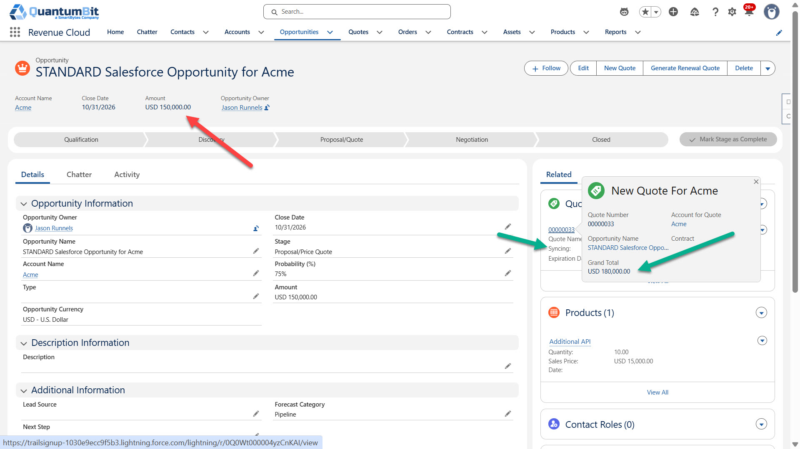

Native Opportunity Products have no concept of term length. The same problem compounds across every layer of deal complexity:

- **Attribute-based pricing** - the same product's Annual PSM has a list price of $15,000 but reprices to $10,000 through the Revenue Cloud pricing engine. A manually entered Opportunity Product captures neither the term nor the waterfall.
- **Ramp deals** - Year 1 at 10 units, Year 2 at 20, Year 3 at 30, potentially at different discount structures. Opportunity Amount has no model for this.
- **Bundles** - a bundle parent often carries $0; pricing lives on the components. Opportunity Products can't represent bundle economics.
- **Mid-term amendments** - an amendment quote is a delta transaction representing the incremental change, not the full renewed value. Opportunity Amount won't tell you the net new impact.

**The Revenue Cloud Quote - and its underlying Quote Line Items, Quote Line Groups, and ProductSellingModels - is the only place in the system where deal economics are computed correctly.** This component surfaces that data where sellers and managers need it: on the Quote record, during the deal.

---

## What the Component Surfaces

The **Deal Metrics** tab on a Quote record shows three sections.

### Deal Summary

| Field | Description |
|---|---|
| Deal Type | Classification driven by QuoteAction type and ramp structure - New Business, Amendment, Renewal, Cancellation, or Ramped Deal variants |
| Customer Lifecycle Type | Net-new MRR direction: New Business, Expansion, Flat Renewal, or Contraction |
| Deal Start Date | Start date of the first Quote Line Group or Quote Line Item |
| Deal End Date | End date of the last Quote Line Group or Quote Line Item |
| Effective Deal Term | Calendar months from Deal Start to Deal End |
| Term of Related Contract | Term from the linked Contract record, shown in **orange** when it does not match the Effective Deal Term - a data quality flag |

### Deal Financials

| Field | Description |
|---|---|
| TCV (This Deal) | Total Contract Value - all QLG SummarySubtotals (ramp) or all QLI TotalPrices (flat), including one-time fees |
| Blended ACV | Annualized TCV: `TCV ÷ (Effective Term Months ÷ 12)`. See note below. |
| Projected Year 1 MRR | Subscription-only MRR for the first period ÷ 12. One-time fees excluded. |
| Net New MRR | Incremental MRR contribution of this deal. Logic varies by deal type - see [Net New MRR Logic](#net-new-mrr-logic). |
| One-Time / Non-Recurring Fees | Sum of all QLIs with a one-time ProductSellingModel (no EndDate). Kept separate from all recurring metrics. |
| Account Booked TCV (For Reference) | Forward-looking contracted revenue across all active Assets for this account: `sum(AssetStatePeriod.Mrr × months)` for all future periods. Read live; not stored on Quote. |
| Account Current MRR (For Reference) | Sum of `Asset.CurrentMrr` for all active Assets on this account. Read live; not stored on Quote. |

> **For SEs: these two numbers together are the story.** Blended ACV is what the pipeline manager, sales leader, and comp plan need - an annualized deal value for quota tracking and forecasting rolls. Projected Year 1 MRR is what actually hits the books in period one. On a 3-year ramp, those numbers diverge significantly: a deal with Year 1 = $100K, Year 2 = $200K, Year 3 = $300K has a Blended ACV of $208K but a Year 1 MRR of $8,333/month. Without Revenue Cloud, you cannot produce either number correctly from native Salesforce - there is no term, no ramp structure, and no PSM-aware pricing in a standard Opportunity Product. That gap is the conversation.

### Per Year Forecast *(ramp deals only)*

A table showing ACV and MRR per Quote Line Group segment. Only appears when the quote has ramped QLGs. One-time fees are excluded from ACV and MRR columns and reported separately in Deal Financials.

| Column | Description |
|---|---|
| Period | QLG Name (e.g., Year 1, Year 2, Year 1 - Amend) |
| Start | Segment start date |
| End | Segment end date |
| ACV | Subscription QLI total for this segment |
| MRR | ACV ÷ 12 |

---

## Net New MRR Logic

Net New MRR is not the same calculation for every deal type.

| Deal Type | Net New MRR | Why |
|---|---|---|
| New Business | Year 1 MRR | No prior base to subtract |
| Amendment | Year 1 MRR of this quote | Amendment lines represent only the delta - the incremental change, not the full new state |
| Renewal | Year 1 MRR − Account Current MRR | Only on renewals does Year 1 MRR represent the full renewed total; the delta against baseline is meaningful |
| Cancellation | − Account Current MRR | Full base is being removed |

Customer Lifecycle Type is derived from Net New MRR: positive = Expansion, negative = Contraction, zero with active assets = Flat Renewal, zero with no prior assets = New Business.

---

## Use Cases

### New Business

A simple 12-month term deal. TCV = Blended ACV. Account Current MRR = $0 (no prior assets). Net New MRR = Year 1 MRR.

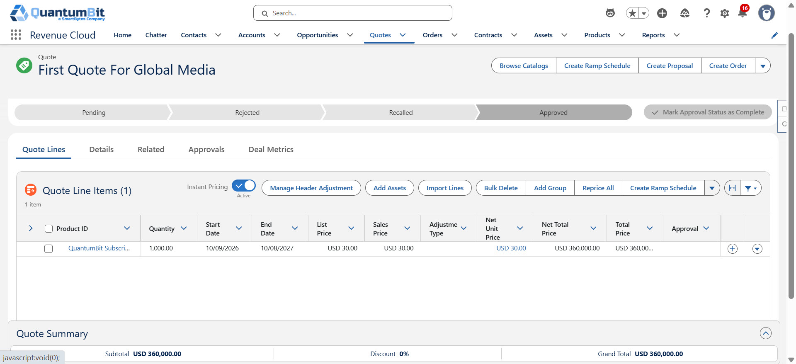
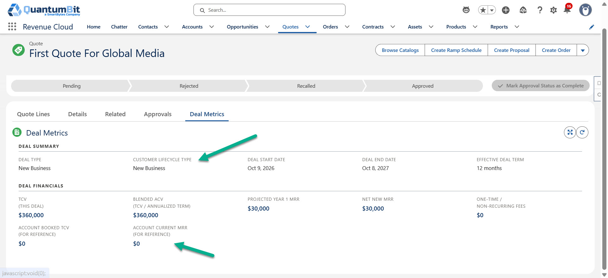

---

### Amendment - Mid-Term Expansion

An amendment quote is a **delta transaction** - lines represent the incremental change, not the full new state. Here, additional units are added mid-contract. The prorated Asset carries the new total quantity forward from the amendment date.

Customer Lifecycle Type = **Expansion** because Net New MRR (the amendment's incremental contribution) is positive. Account Current MRR shows the full existing install base.

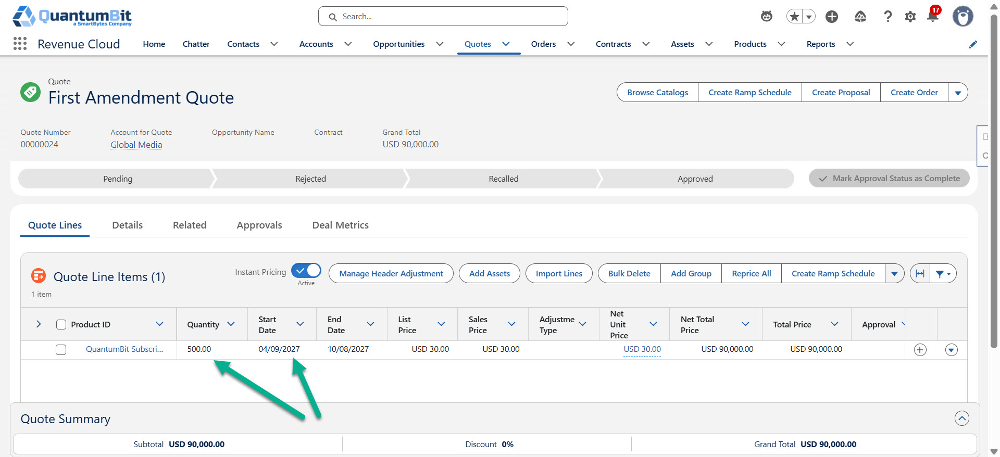
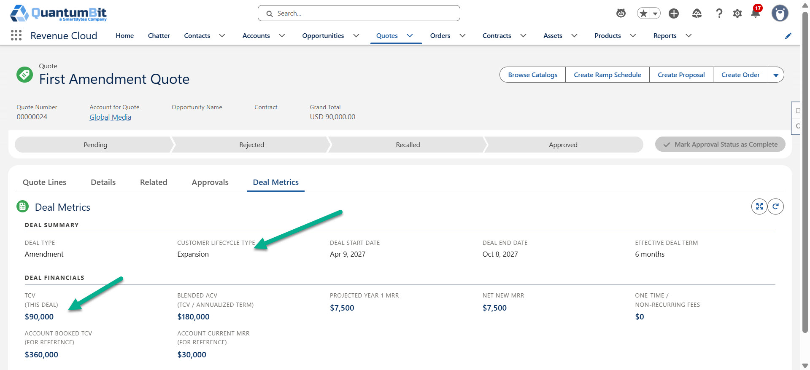

---

### Ramp Deal with One-Time Fees

A 3-year ramp schedule with increasing quantities per year, plus a Professional Services one-time fee in Year 1.

- **Projected Year 1 MRR** reflects subscription-only revenue - the PS fee is excluded
- **One-Time / Non-Recurring Fees** isolates the PS amount separately
- **Term of Related Contract** appears in orange - the linked Contract is 12 months but the deal runs 36 months, surfacing a potential data quality issue automatically
- **Per Year Forecast** shows the ramp step-ups: Year 1 ACV ≠ Year 2 ACV ≠ Year 3 ACV

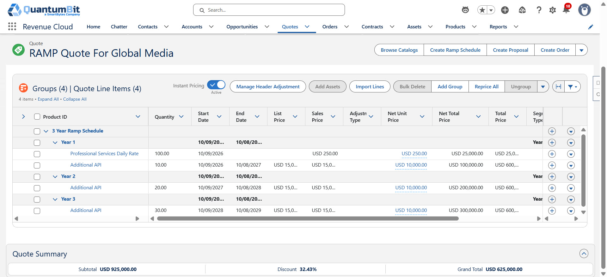
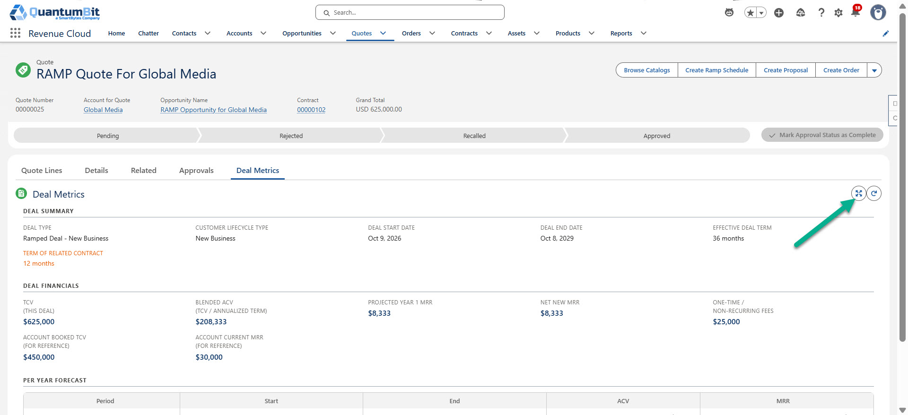
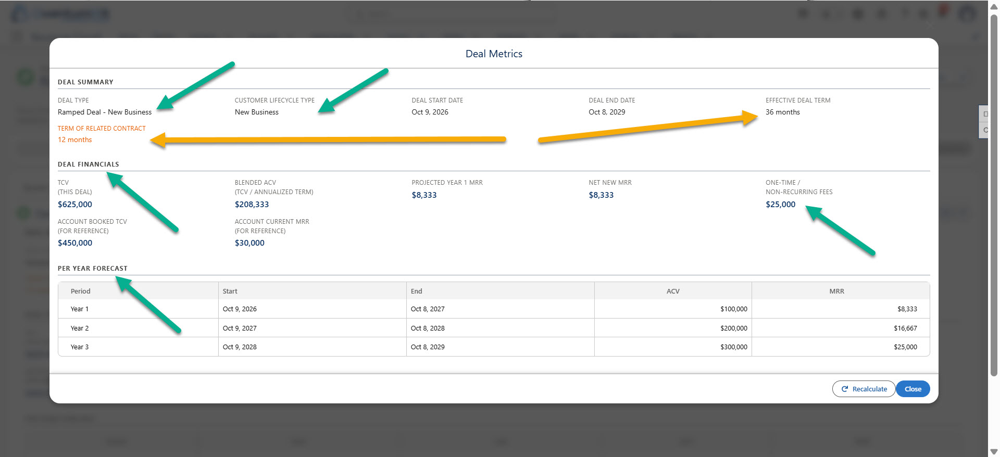

---

### Amending a Ramp Deal

An amendment adds a new product across all three ramp segments. The amendment quote's first segment is a partial period ("Year 1 - Amend") reflecting the prorated time from the amendment date to the original segment end.

Deal Type = **Ramped Deal**. Customer Lifecycle Type = **Expansion**. Account Current MRR reflects all active assets across the account.

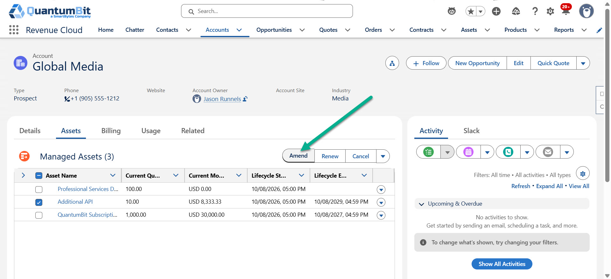
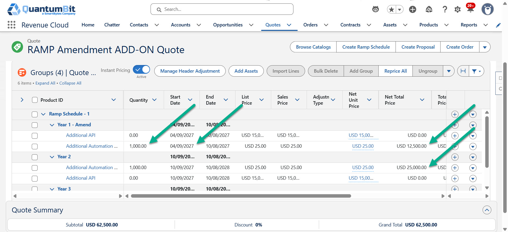
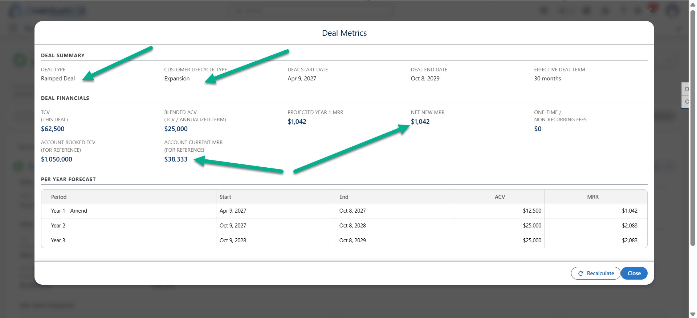

---

### Cancellation

A cancellation quote carries negative quantities. All Deal Financials metrics are negative. Customer Lifecycle Type = **Contraction**.

Note: Blended ACV on a partial-period cancellation annualizes the TCV, so its absolute value will appear larger than TCV. This is expected - it represents the annualized rate of the removed revenue, not the total TCV impact.

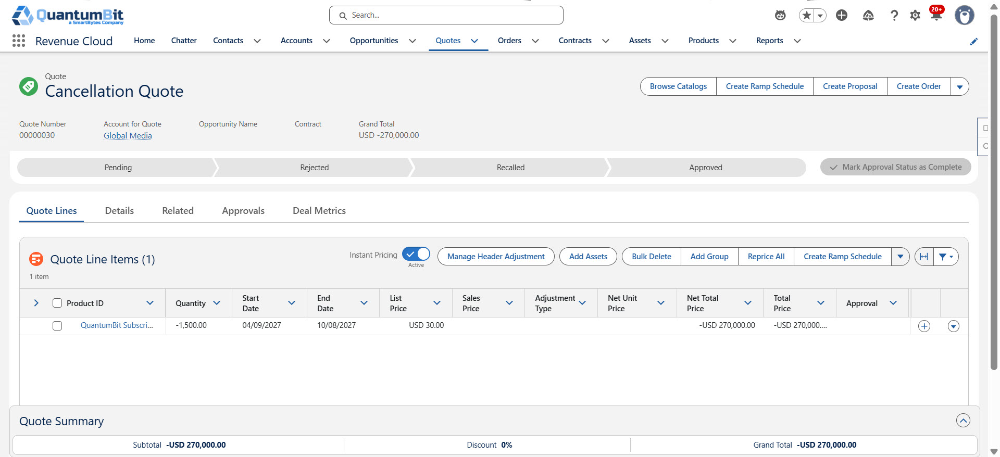
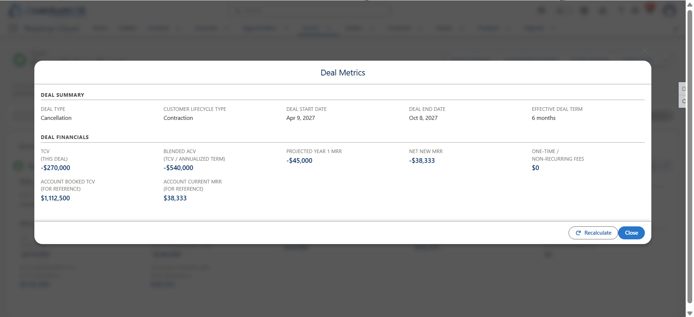

---

### Bundle Quote

A bundle with subscription components (Database, API Access, Additional Messages) and one-time components (Professional Services, Training). The bundle parent carries $0; all pricing lives on the components.

One-Time / Non-Recurring Fees correctly isolates the PS and Training components. Projected Year 1 MRR and TCV reflect only the recurring subscription components.

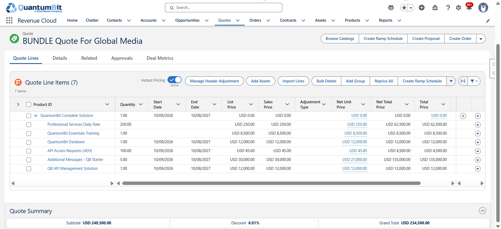
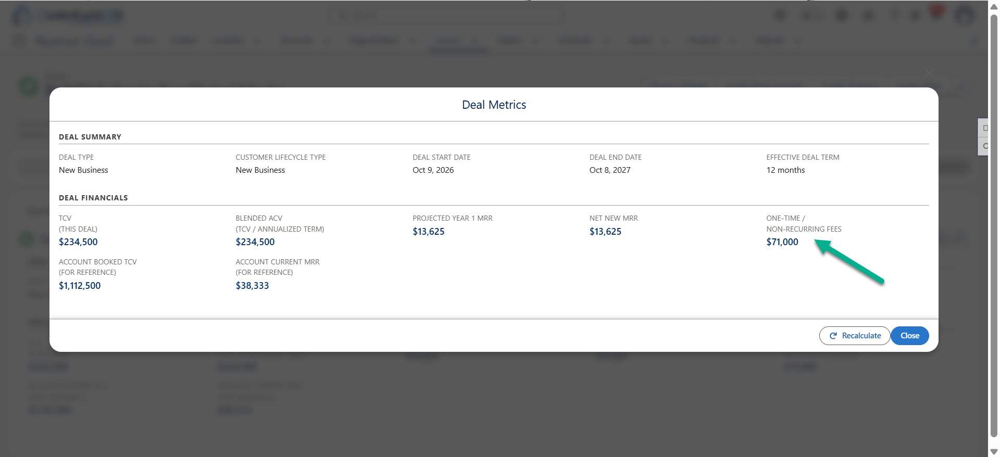

---

### Renewal with Uplift

A renewal quote at increased quantities. Deal Type = **Renewal**. Customer Lifecycle Type = **Expansion** because Net New MRR (Year 1 MRR − Account Current MRR) is positive - the renewal grew above the prior run-rate. Account Booked TCV reflects all contracted future revenue across active assets.

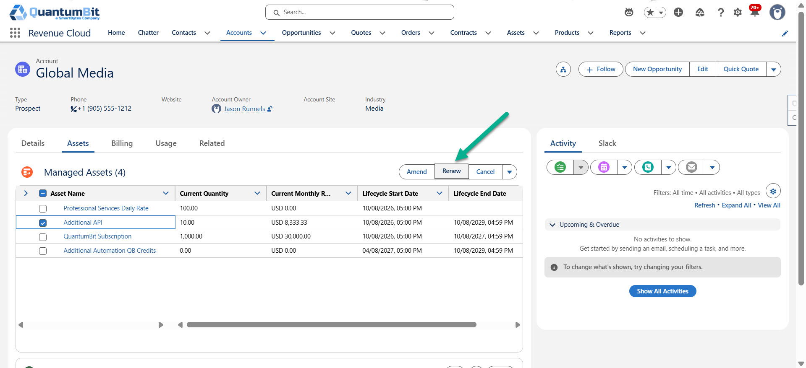
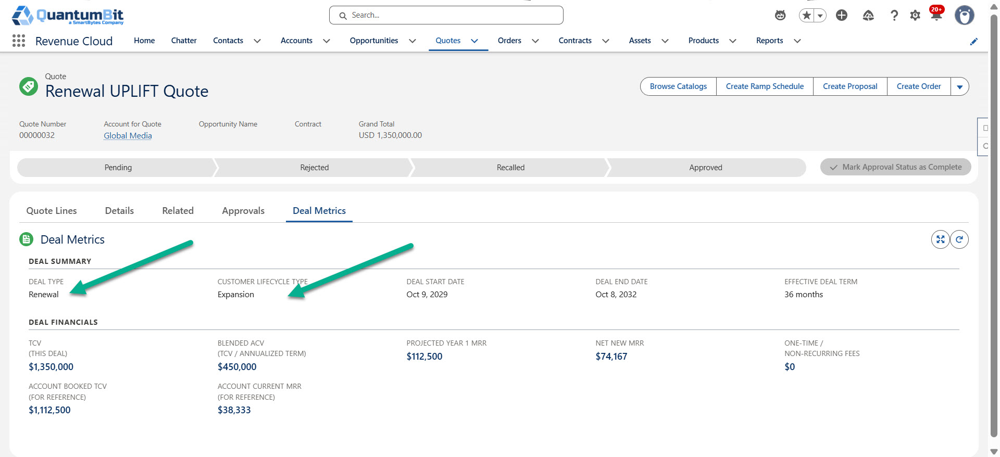

---

## Relationship to RMI Dashboards

These two analytics surfaces are complementary.

| | RMI Dashboards | Quote Deal Metrics |
|---|---|---|
| **Scope** | Aggregate, trend-based, book of business | Deal-specific, single quote |
| **Timing** | Post-activation - Orders and Assets | Pre-close - Quote Line Items |
| **Audience** | Finance, RevOps, CS leadership | Seller, deal desk, account exec |
| **Key questions** | Renewal rates, churn risk, ARR trends | This deal's TCV, Net New MRR, ramp structure |

RMI tells you the forest. Deal Metrics tells you about the tree.

The gap RMI doesn't fill is the **in-deal conversation** - when a seller is on a call structuring a 3-year ramp, they need to see deal economics on the Quote record right now, not after it activates into assets.

---

## Deployment

### Prerequisites

- Salesforce Revenue Cloud (RLM), API version 62+
- Lightning Experience, Quote record page

### Metadata Components

| Component | Type | Purpose |
|---|---|---|
| `RLM_Quote_Deal_Metrics` | Flow (AutoLaunched) | Calculates all metrics and writes to Quote custom fields |
| `QuoteDealMetricsController` | Apex Class | Reads live account-level data: Current MRR, Booked TCV, contract term, per-period table |
| `quoteDealMetrics` | Lightning Web Component | Renders the Deal Metrics tab on the Quote record page |
| Custom fields on `Quote` | Metadata | Stores calculated metrics; see field list below |

### Custom Quote Fields

| API Name | Type | Description |
|---|---|---|
| `TCV__c` | Currency | Total Contract Value |
| `Blended_ACV__c` | Currency | Annualized TCV |
| `Projected_Year1_MRR__c` | Currency | Subscription-only Year 1 MRR |
| `Net_New_MRR__c` | Currency | Incremental MRR contribution of this deal |
| `One_Time_Non_Recurring_Fees__c` | Currency | Sum of all one-time PSM line amounts |
| `Deal_Type__c` | Text | Computed deal classification |
| `Customer_Lifecycle_Type__c` | Text | Expansion / Contraction / Flat Renewal / New Business |
| `Deal_Start_Date__c` | Date | First period start date |
| `Deal_End_Date__c` | Date | Last period end date |
| `Effective_Deal_Term_Months__c` | Number | Calendar months from Deal Start to Deal End |

### Deploy

```bash
sf project deploy start \
  --source-dir force-app/main/default/flows/RLM_Quote_Deal_Metrics.flow-meta.xml \
  --source-dir force-app/main/default/classes/QuoteDealMetricsController.cls \
  --source-dir force-app/main/default/classes/QuoteDealMetricsController.cls-meta.xml \
  --source-dir force-app/main/default/lwc/quoteDealMetrics \
  --target-org <your-org-alias>
```

### Post-Deploy Steps

1. **Activate the flow.** Go to Setup → Flows → `RLM_Quote_Deal_Metrics` and set it to Active.
2. **Add fields to the Quote page layout.** All `*__c` fields need to be on the layout for users to see stored values.
3. **Grant FLS.** Grant Read and Edit visibility on all custom Quote fields to relevant profiles. The flow and Apex run `without sharing`, but FLS still applies to the LWC wire calls.
4. **Add the LWC to the Quote record page.** In Lightning App Builder, add `quoteDealMetrics` as a new tab on the Quote record page and label it **Deal Metrics**.

---

## Design Notes

**Billing forecast is intentionally excluded.** BillingSchedules and BillingScheduleGroups provide the authoritative billing operations forecast downstream from the Order. Adding billing frequency or estimated invoice amounts to this component would introduce noise - especially for usage-based products (where committed ≠ invoiced) and quotes with mixed billing frequencies. This component is scoped to sales and sales leader deal economics only.

**Metrics are a snapshot.** Calculated values are stored on the Quote at the time of the last Recalculate. They do not auto-update when lines change. The Recalculate button re-triggers the flow on demand.

**Account-level metrics are always live.** Account Current MRR and Account Booked TCV are read from Assets and AssetStatePeriods at page-load time and are never stored on the Quote. They always reflect the current account state.

**RLM transaction quote AccountId is always null.** All RLM-generated Amendment, Renewal, and Cancellation quotes have `Quote.AccountId = null` by platform behavior. The component resolves the account via `QuoteAction.SourceAssetId → Asset.AccountId` automatically.

**Splitting multi-year deals across multiple Opportunities is an anti-pattern.** It fragments pipeline, creates attribution noise, and is operationally complex. The correct model is one Opportunity → one multi-year Quote → Deal Metrics surfaces the per-period picture without splitting the record.
